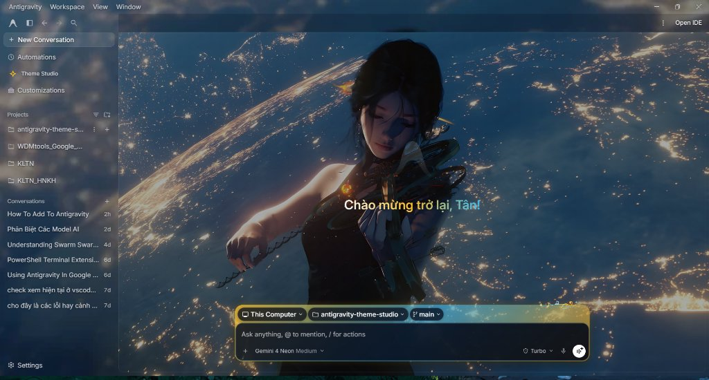
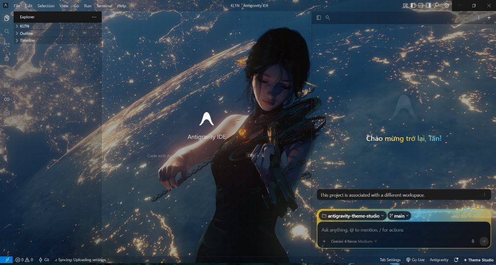
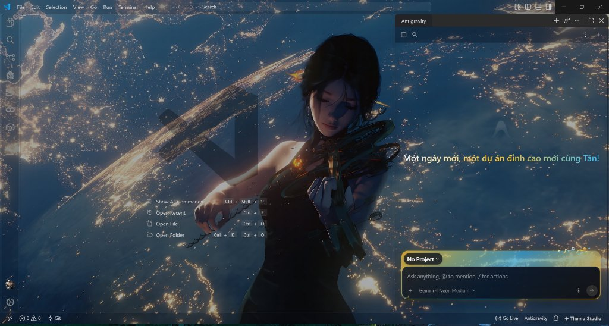

# Antigravity Theme Studio — Rust Edition (`ats-theme`)

> **1 Repo duy nhất — Custom giao diện đồng bộ cho cả 3 ứng dụng: Antigravity App, Antigravity IDE và Visual Studio Code!**

Hệ thống tùy biến giao diện **Live Video / Image / Gradient Wallpaper + SVG Ornaments + Boot HUD + Custom Greeting + Task Complete Audio** hoạt động mượt mà và đồng bộ cấu hình trực tiếp trên cả **3 nền tảng**:
- **Antigravity App** (cổng CDP `9222`) — Unified L-Glass Sidebar, Wallpaper/Video toàn màn hình, Custom Greeting & Composer Ornament
- **Antigravity IDE** (cổng CDP `9223`) — Trong suốt Workbench, Explorer, Editor và đồng bộ nền 1:1 xuyên sang khung chat Antigravity bên phải
- **Visual Studio Code** (cổng CDP `9224`) — Custom toàn bộ giao diện VS Code + Antigravity Extension Panel liền mạch thành một bức nền duy nhất

Được viết lại hoàn toàn bằng **Rust thuần (Pure Rust)**, hoạt động qua Chrome DevTools Protocol (CDP), **không can thiệp vào tệp cài đặt gốc (`app.asar`)**, **không làm bẩn `settings.json`**, và **loại bỏ hoàn toàn yêu cầu Node.js, Python, Pillow hay `wscript.exe`/`silent-start.vbs`**.

---

## Demo thực tế trên cả 3 ứng dụng

### 1. Antigravity App


### 2. Antigravity IDE


### 3. Visual Studio Code (kèm Antigravity Extension)


---

## Các tối ưu RAM, CPU & FPS (Rust Edition v2.0)

| Hạng mục | Bản cũ (Node.js + Python) | Bản Rust (`ats-theme`) |
| :--- | :--- | :--- |
| **Runtime yêu cầu** | Node.js >= 22 + Python 3 + `wscript.exe` | **Không cần runtime** (2 binary native độc lập ~1.1 MB) |
| **RAM daemon chạy ngầm** | ~45 – 75 MB (V8 heap) | **~1.0 – 1.5 MB Working Set (~0.8 MB Private RAM)** |
| **Thời gian build `dist/bundle.js`** | ~300 – 800 ms (Python startup) | **~1 – 4 ms** (`ats-theme build`) |
| **Khởi chạy ngầm Windows** | `wscript.exe` + `silent-start.vbs` | **Windows Task Scheduler (`AntigravityThemeStudio`)** chạy trực tiếp `ats-theme-daemon.exe` (`windows_subsystem = "windows"`) |
| **Tối ưu V8 Heap trong Electron** | Gọi `Runtime.enable` giữ console log & `RemoteObject` | **Bỏ `Runtime.enable`** (chỉ dùng `Page.enable` + `Runtime.addBinding`), giải phóng V8 heap cho Antigravity & VS Code |
| **Xử lý chuỗi ảnh Base64 & Glass** | Gán trực tiếp `data:` URI hàng trăm KB vào inline CSS | **Chuyển sang `blob:` Object URL (~60 bytes)** + LRU cache tự `URL.revokeObjectURL` |
| **Cập nhật `clip-path` & L-Glass** | Set inline CSS variables trên `.agy-shell` gây recalc toàn cây DOM | **Tách riêng `<style id="ats-metrics-style">`** chỉ cập nhật pseudo-element `::before`/`::after` |
| **Chống tụt FPS khi AI stream chữ** | `MutationObserver` gọi `getBoundingClientRect()` mỗi frame | **0 `:has()` selector**, chỉ đo lại layout khi `ResizeObserver` đổi kích thước hoặc đóng/mở split browser |

---

## Tính năng tích hợp

- **Hỗ trợ đồng bộ đa ứng dụng (Antigravity + Antigravity IDE + VS Code):**
  - Tự động làm trong suốt Workbench, Explorer, Editor, Welcome Page và đồng bộ tọa độ ảnh/video nền **1:1 xuyên qua khung chat `extensionView` bên phải** ở mọi kích thước cửa sổ và mức zoom.
- **Video nền động & Ảnh nền độ phân giải cao (Local Rust HTTP Media Server):**
  - Phát video qua HTTP Media Server nội bộ bằng Rust hỗ trợ `Range 206 Partial Content` (tự động `pause()` khi chuyển sang ứng dụng khác hoặc thu nhỏ cửa sổ để tiết kiệm GPU/pin, tự động `play()` khi quay lại).
  - Tự động mã hóa `data:` URI -> `blob:` URL cho ảnh nền (và video `.webm` ≤ 25MB) trên IDE / VS Code để vượt qua giới hạn CSP của `vscode-file://`.
- **In-App Theme Studio (nút `Theme Studio` trên Sidebar / Status Bar hoặc phím tắt `Ctrl + Shift + T`):**
  - Chuyển đổi giữa **Video động / Ảnh tĩnh / Gradient** và **8 preset sẵn có** (`Dark Glass Live`, `Neon Cyberpunk`, `Midnight Obsidian`, `Frost Light`, `WLOP Cosmic`, `Cyber Neon Pulse`, `Ember Crimson`, `Kyoto Matcha Light`), hỗ trợ hiển thị **SVG Ornaments** (`sticker` & `cornerSvg`) trên bong bóng chat và khung Composer.
  - Có **Thumbnail xem trước** cho cả Video và Ảnh tĩnh, tùy chỉnh **Object Position** (Căn trên / giữa / dưới), **Dim Overlay**, **Pre-baked Glass Blur** (debounce 80ms + LRU 4 mục, 0 live blur — cuộn mượt 60–120 FPS), **Accent Color Override**, kiểu bong bóng chat, khung Composer và **User/Agent Avatar** (tự nén WebP 192×192).
  - Hỗ trợ **Xuất / Nhập file cấu hình JSON** và **Đặt lại mặc định** (xác nhận 2 bước chống bấm nhầm).
  - Upload trực tiếp Video, Ảnh, Âm thanh theo luồng (**Stream Upload + Stream RFC 1321 MD5** tới 150MB trong Rust, không ngốn RAM) và xóa trực tiếp khỏi ổ đĩa.
- **Task Complete Sound & Boot HUD Audio:**
  - Phát âm báo khi Agent hoàn thành tác vụ (chống kêu trùng lặp khi mở nhiều cửa sổ cùng lúc qua `/api/claim-sound`, tự bỏ qua khi bấm hủy).
  - Màn hình khởi động **Boot HUD** đi kèm âm thanh **Sci-Fi Glass Synth** (hoặc tải file âm thanh khởi động riêng), chỉ phát 1 lần mỗi phiên mở cửa sổ.

---

## Hướng dẫn cài đặt & sử dụng nhanh (Windows)

### Cách 1: Click đúp `ats-theme.bat` (Khuyên dùng — menu tiếng Việt 1-click)

1. Double-click vào file **[`ats-theme.bat`](ats-theme.bat)** ở thư mục gốc (lần đầu mở sẽ tự chạy `cargo build --release` nếu chưa có binary):
   - **`[1]` Cài đặt & Chạy ngầm tự động**: build `dist/bundle.js` (~2 ms), gắn cờ `--remote-debugging-port` (`9222`/`9223`/`9224`) vào shortcut của cả 3 app, đăng ký & chạy **Windows Scheduled Task (`AntigravityThemeStudio`)**.
   - **`[2]` Build lại bundle**: sau khi sửa `themes/presets.json` hoặc `runtime/style.css` (daemon tự hot-reload trong ~150 ms).
   - **`[3]` Kiểm tra trạng thái & RAM thực tế** (`status`).
   - **`[4]` Kiểm tra live trên Antigravity / IDE / VS Code** (`verify`).
   - **`[5]` Xem danh sách preset** (`themes`).
   - **`[6]` Chế độ Watch Mode**: tự động rebuild + hot-reload mỗi khi lưu `presets.json`, `style.css` hoặc `engine.js`.
   - **`[7]` Tạm dừng daemon** (`stop`).
   - **`[8]` Gỡ cài đặt sạch sẽ** (`uninstall`).
   - **`[9]` Build lại binary Rust** (`cargo build --release`).

### Cách 2: Dùng dòng lệnh (`ats-theme.exe` hoặc `npm run ...`)

```powershell
# 1. Biên dịch bản Release (chỉ cần chạy 1 lần)
cargo build --release

# 2. Cài đặt (build dist/bundle.js, đăng ký Task Scheduler & gắn cờ CDP vào shortcut của cả 3 app)
.\target\release\ats-theme.exe install
# Hoặc: npm run install-win

# 3. Mở ứng dụng kèm cổng CDP (hoặc mở trực tiếp từ Start Menu / Taskbar)
npm run launch          # Mở Antigravity (port 9222)
npm run launch-ide      # Mở Antigravity IDE (port 9223)
npm run launch-vscode   # Mở Visual Studio Code (port 9224)

# 4. Kiểm tra trạng thái & RAM daemon
.\target\release\ats-theme.exe status
.\target\release\ats-theme.exe verify
```

## Gỡ cài đặt hoàn toàn

```powershell
.\target\release\ats-theme.exe uninstall
# Hoặc: npm run uninstall
```
*(Lệnh trên sẽ xóa Scheduled Task/Startup shortcut, dừng daemon, gỡ cờ `--remote-debugging-port` khỏi các shortcut và khôi phục ngay giao diện gốc trên tất cả cửa sổ đang mở).*

---

## Credits & Attribution

- Các preset `WLOP Cosmic`, `Cyber Neon Pulse`, `Ember Crimson`, `Kyoto Matcha Light` cùng bộ asset `wlop_cosmic_2k.webp`, `wlop_corner.svg`, `wlop_ornament.svg` được tích hợp từ [antigravity-custom-theme-rust](https://github.com/chinhzz108/antigravity-custom-theme-rust) (MIT License).
